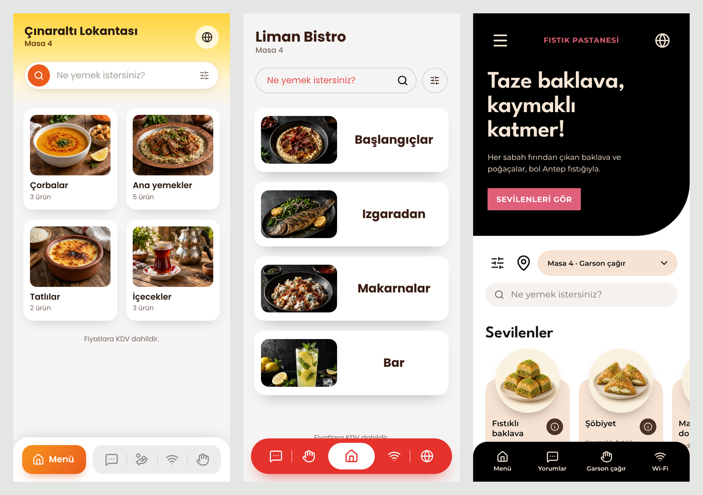
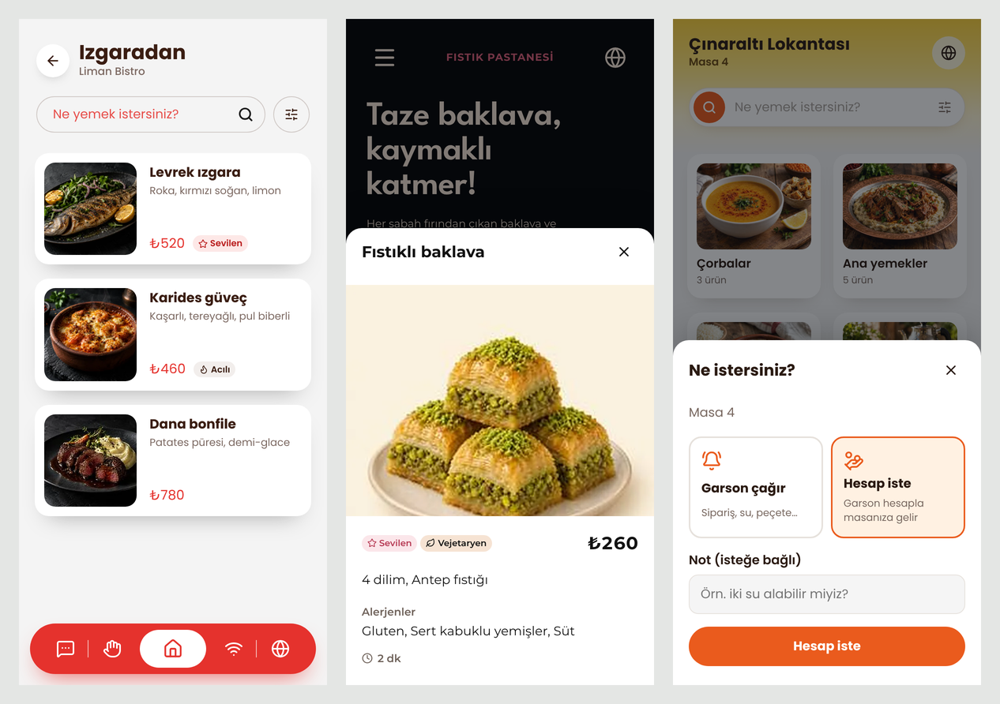
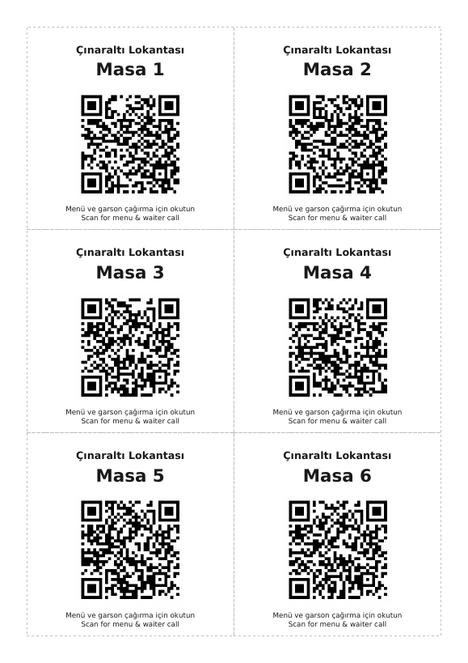
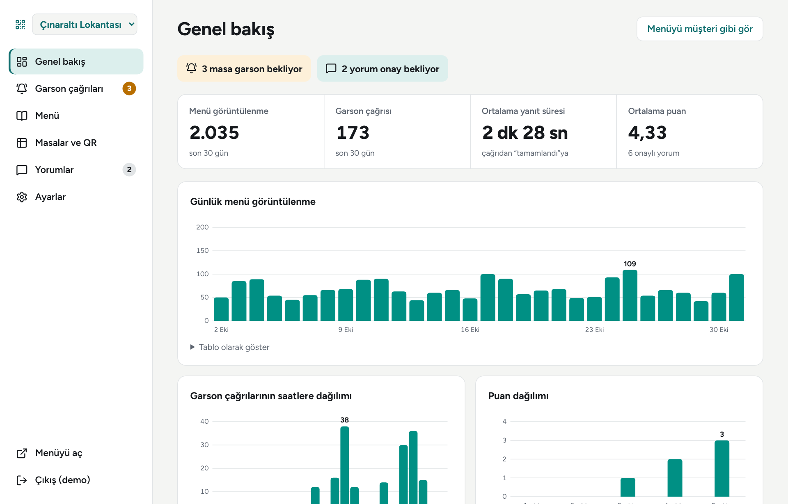
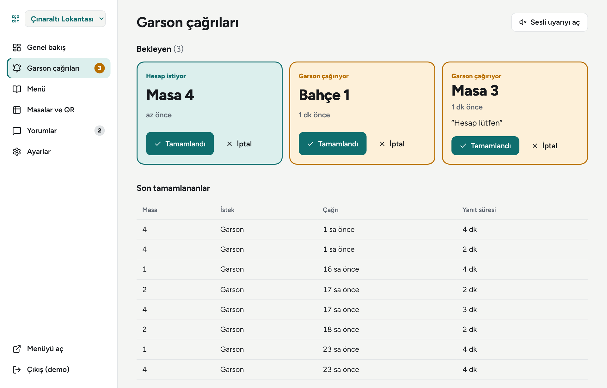
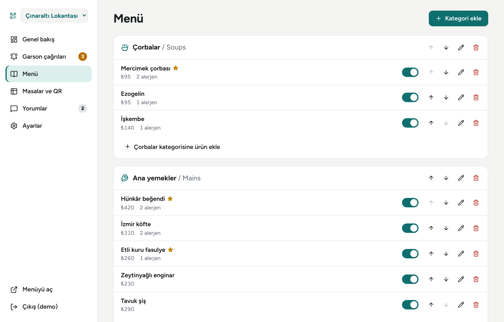
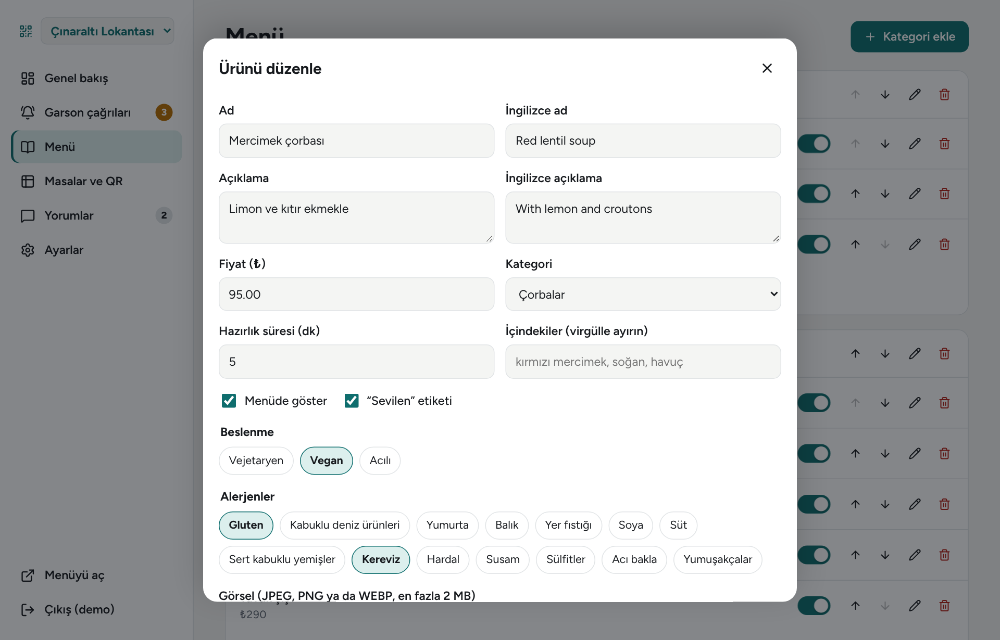
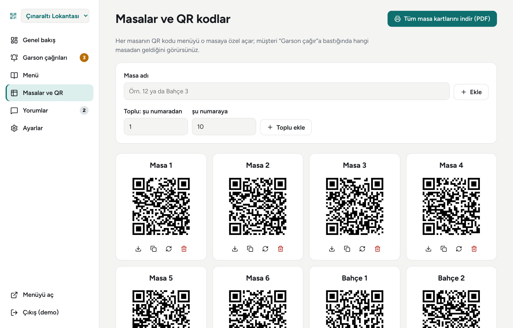
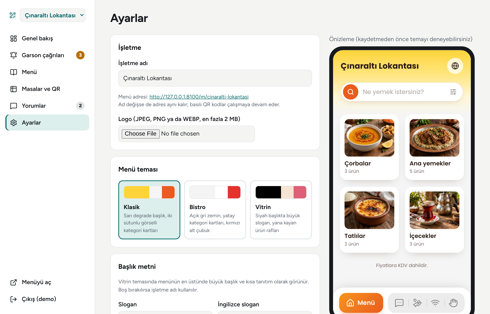
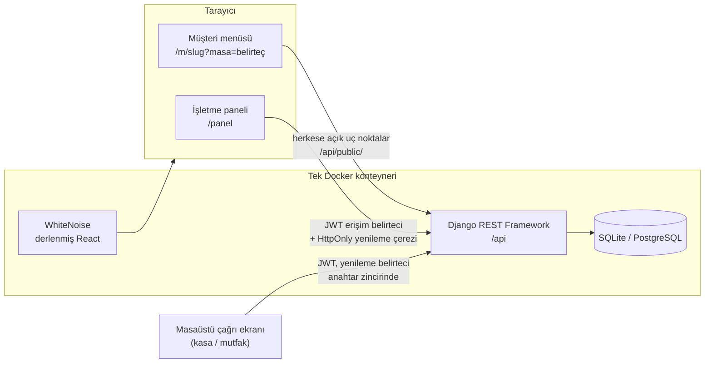

# QR Menü

[](https://github.com/melisayalcinkaya/qr_menus/actions/workflows/ci.yml)


[](https://qr-menus.onrender.com)
[](LICENSE)

Restoran ve kafeler için QR kodlu dijital menü. Müşteri masadaki kodu okutur; menüyü kendi dilinde görür, alerjenlere göre süzer ve tek dokunuşla garson çağırır. İşletme sahibi menüsünü, masalarını, gelen çağrıları ve yorumları tek bir panelden yönetir.

**Canlı demo:** https://qr-menus.onrender.com (ilk açılış, ücretsiz sunucu uyandığı için 30–60 saniye sürebilir)

- Masa 4'ten menü ve garson çağırma: [Çınaraltı Lokantası](https://qr-menus.onrender.com/m/cinaralti-lokantasi?masa=demo-klasik-4), [Liman Bistro](https://qr-menus.onrender.com/m/liman-bistro?masa=demo-bistro-4), [Fıstık Pastanesi](https://qr-menus.onrender.com/m/fistik-pastanesi?masa=demo-vitrin-4)
- İşletme paneli: https://qr-menus.onrender.com/panel
- API dokümantasyonu: https://qr-menus.onrender.com/api/docs/

Panel için demo hesabı: `demo` / `demo-sifre-2026`. Tüm demo verileri kurgusaldır; yemek görselleri yapay zekâ ile üretilmiştir.



## Çözdüğü sorun

Basılı menüler güncellenemez, alerjen bilgisi taşımaz ve yabancı misafire hitap etmez. Garsona ulaşmak için el kaldırıp beklemek gerekir. Bu proje:

- Menüyü **masaya özel** bir QR koduyla açar; garson çağrısında ya da hesap isteğinde hangi masa olduğu otomatik bilinir.
- Ürünü panelden pasifleştirmek onu **anında** menüden kaldırır; yeniden basım gerekmez.
- 14 yasal alerjen grubunu standart kodlarla tutar ve müşterinin menüyü **süzmesini** sağlar.
- İşletmeye ziyaret, yoğun saat ve garson yanıt süresi gibi **ölçülebilir** veriler verir.

## Özellikler

**Müşteri menüsü** (uygulama indirmeden, telefon tarayıcısında)
- Üç tema, tek davranış: **Klasik** (sarı degrade başlık, iki sütunlu görselli kategori kartları), **Bistro** (yatay kategori kartları, sayfalama, kırmızı alt çubuk), **Vitrin** (siyah başlıkta slogan, yana kayan ürün rafları). Temalar yalnızca görünümü değiştirir; veri, süzgeç ve çağrı mantığı ortaktır
- Kategoriden ürünlere, üründen ayrıntıya (içindekiler, alerjenler, hazırlık süresi) giden sade gezinme; masa bağlantısı sayfalar arasında korunur
- Türkçe ve İngilizce; telefonun diline göre açılır, İngilizce alan boşsa Türkçeye düşer
- Türkçe harflere duyarsız arama ("manti" → Mantı), alerjen ve vegan/vejetaryen/acılı süzgeci
- Masa QR'ıyla açıldığında **garson çağırma** ve **hesap isteme**, isteğin canlı durumu
- Wi-Fi bilgisi (kopyala düğmesiyle) ve işletme onayından geçen yorumlar

**İşletme paneli**
- Canlı çağrı panosu: 5 saniyede bir yenilenir, hesap istekleri ayrı renkte, isteğe bağlı zil sesi, sekme başlığında bekleyen sayısı
- Menü düzenleyici: kategoriler (ikonlu), ürünler, iki dilde içerik, alerjenler, görsel, sıralama, tek tıkla gizleme
- Masalar: tekli/toplu ekleme, QR önizleme ve indirme, sızan bir QR'ı geçersiz kılmak için yeni kod üretme, **tüm masa kartları tek PDF**
- Yorum moderasyonu, slogan ve kısa tanıtım (TR/EN), kaydetmeden önce canlı tema önizlemesi
- İstatistikler: günlük ziyaret, saatlere göre çağrı, ortalama yanıt süresi, puan dağılımı

**Masaüstü çağrı ekranı** ([qr-menu-desktop](https://github.com/melisayalcinkaya/qr-menu-desktop))
- Kasa ya da mutfak bilgisayarı için aynı API'yi kullanan PySide6 uygulaması: sistem tepsisinde çalışır, yeni çağrıda zil ve bildirim verir, tükenen ürünü tek tıkla gizler
- Windows için tek dosyalık `.exe`

**Geliştirici tarafı**
- OpenAPI şeması ve Swagger arayüzü: `/api/docs/`
- 70 backend + 24 frontend testi (üç tema da sahte API ile uçtan uca çiziliyor), %90 kapsam alt sınırı, Docker imajını açıp deneyen CI
- Tek Docker imajı; Render'a tek tıkla kurulum (`render.yaml`)

| Kategori, ürün ayrıntısı ve hesap isteme | Basılabilir masa kartları (PDF) |
|---|---|
|  |  |



<details>
<summary>Diğer panel ekranları</summary>







</details>

## Mimari



- **backend/**: Django 5.2, DRF, SimpleJWT, drf-spectacular, ReportLab (PDF), qrcode
- **frontend/**: React 19, React Router 7, Vite; UI kütüphanesi yok, sade CSS ve tema değişkenleri
- Yönetim uç noktaları (`/api/businesses/`, `/api/products/` …) yalnızca sahibine açık; müşteri uç noktaları ayrı bir önek altında (`/api/public/<slug>/`)

## Güvenlik

Projenin ilk sürümünde bulunan açıklar düzeltildi ve her biri için regresyon testi yazıldı (`backend/api/tests/test_security.py`).

| Önceki durum | Şimdi |
|---|---|
| Herkes, her işletmenin garson çağrılarını (masa, not) listeleyebiliyordu | Varsayılan izin `IsAuthenticated`; her sorgu sahibine göre süzülüyor, başkasının kaydı 404 |
| Bir işletme sahibi ürününü rakibin kategorisine taşıyıp onun menüsüne ekleyebiliyordu (IDOR) | İlişkili alanlar yalnızca kullanıcının kendi kayıtlarını kabul ediyor; kategori tek işletmeye ait |
| Herkese açık yorum listesi yorumcuların e-postalarını döndürüyordu | E-posta alanı tamamen kaldırıldı (veri minimizasyonu); müşteriye ayrı, dar serializer |
| "1" şifresiyle kayıt olunabiliyordu, hız sınırı yoktu | Django şifre kuralları, benzersiz e-posta; giriş, yorum ve çağrı için hız sınırı |
| JWT'ler `localStorage`'daydı | Erişim belirteci yalnızca bellekte (15 dk); yenileme belirteci `HttpOnly`, `SameSite=Strict` çerezde, rotasyon ve çıkışta kara liste |
| Gizli anahtar repoda, `DEBUG=True`, her kökene CORS izni | Ayarlar ortam değişkenlerinde; production'da HSTS, güvenli çerezler, CSP ve diğer başlıklar |
| Repoda veritabanı, `venv/` ve yüklenen dosyalar (376 MB) | Geçmişten temizlendi (348 KB) |
| Görsel olarak her dosya kabul ediliyordu | İçeriğe bakılarak yalnızca JPEG/PNG/WEBP, en fazla 2 MB |

Diğer önlemler:
- Masa belirteçleri tahmin edilemez; başka işletmenin belirteci geçmez.
- Aynı masadan tekrar basılan "Garson çağır" yeni çağrı açmaz (idempotent, `select_for_update`); açık çağrı varken hesap istenirse çağrı "hesap"a yükseltilir, panoda aynı masa için iki kart oluşmaz.
- Yorumlar onaylanmadan yayımlanmaz ve işletme sahibi yorum metnini değiştiremez.
- Konteyner root olmayan bir kullanıcıyla çalışır.

## Kurulum

Gereksinimler: Python 3.12+, Node.js 22+.

```bash
git clone https://github.com/melisayalcinkaya/qr_menus.git
cd qr_menus
cp .env.example .env            # DJANGO_DEBUG=true ile geliştirme anahtarı otomatik kullanılır

# Backend
cd backend
python -m venv .venv && source .venv/bin/activate    # Windows: .venv\Scripts\activate
pip install -r requirements-dev.txt
python manage.py migrate
python manage.py seed_demo      # demo hesabı ve üç örnek işletme
python manage.py runserver

# Frontend (ayrı bir terminalde)
cd frontend
npm install
npm run dev                     # http://localhost:5173 (/api istekleri Django'ya yönlendirilir)
```

Demo menüler: `/m/cinaralti-lokantasi`, `/m/liman-bistro`, `/m/fistik-pastanesi`. Garson çağırmayı ve hesap istemeyi denemek için sonuna `?masa=demo-klasik-4` (ya da `demo-bistro-4`, `demo-vitrin-4`) ekleyin.

### Docker

```bash
docker build -t qr-menu .
docker run -p 8000:8000 -e DJANGO_SECRET_KEY=degistirin -e DJANGO_ALLOWED_HOSTS=localhost \
  -e SECURE_SSL_REDIRECT=false qr-menu
```

### Render'a yayınlama

Depodaki `render.yaml` bir Blueprint tanımıdır: Render panelinde **New → Blueprint** ile bu depoyu seçmeniz yeterli. Gizli anahtar otomatik üretilir, alan adı ve QR adresleri Render'ın verdiği adresten alınır.

## Testler

```bash
cd backend && python manage.py test api        # 70 test
cd frontend && npm test                        # 24 test
```

CI her push'ta şunları çalıştırır: Ruff, eksik migration kontrolü, testler (kapsam %90 altına düşerse başarısız), demo verisi yükleme, ESLint, Vitest, Vite derlemesi. Son olarak Docker imajını production ayarlarıyla başlatıp sayfaların, kimlik doğrulamanın ve güvenlik başlıklarının çalıştığını kontrol eder.

## Bilinen sınırlamalar

- Ücretsiz Render planında disk kalıcı değildir; demo her açılışta sıfırdan yüklenir ve yüklenen görseller yeniden başlatmada kaybolur. Gerçek kullanımda PostgreSQL ve nesne depolama (S3 vb.) gerekir.
- Ücretsiz sunucu bir süre istek gelmezse uykuya geçer; ilk açılış 30–60 saniye sürebilir.
- Canlı çağrı panosu 5 saniyelik yoklamayla (polling) çalışır. Çok sayıda işletmede Server-Sent Events ya da WebSocket (Django Channels + Redis) daha verimli olur.
- Masa belirteci QR'ı fotoğraflayan birinin masaya gelmeden çağrı göndermesini engellemez; bu durumda panelden yeni kod üretilebilir.

## Proje yapısı

```
backend/
  config/            ayarlar, URL'ler, güvenlik başlıkları, SPA sunumu
  api/
    models.py        Business, Category, Product, Table, WaiterCall, Comment, MenuVisit
    views.py         sahip ve herkese açık uç noktalar
    auth_views.py    JWT + HttpOnly yenileme çerezi
    qr.py            QR ve masa kartı PDF'i
    stats.py         panel istatistikleri
    catalog.py       alerjenler, beslenme etiketleri, kategori ikonları
    tests/           güvenlik, yetki, akış, dağıtım testleri
frontend/src/
  lib/               API istemcisi, oturum, süzgeç, biçimlendirme
  menu/              müşteri menüsü ve üç tema
  panel/             işletme paneli
```

## English summary

QR Menu is a digital restaurant menu opened from a per-table QR code (a desktop call screen for the till lives in [qr-menu-desktop](https://github.com/melisayalcinkaya/qr-menu-desktop)). Guests read the menu in Turkish or English, filter it by the 14 legally required allergen groups, and call a waiter or ask for the bill with one tap; the owner sees calls live on a dashboard with an optional chime. Owners manage categories, products, tables (with printable PDF table cards), reviews and a theme with live preview, and get statistics such as average waiter response time.

Built with Django REST Framework and React. The first version had several access-control flaws (anonymous access to waiter calls, cross-tenant product moves, leaked reviewer e-mails, tokens in localStorage); all are fixed and covered by regression tests. Other highlights: OpenAPI docs, CSP and security headers, HttpOnly refresh-token rotation, a single Docker image, and CI that boots the image and smoke-tests it.

## Lisans

[MIT](LICENSE)
